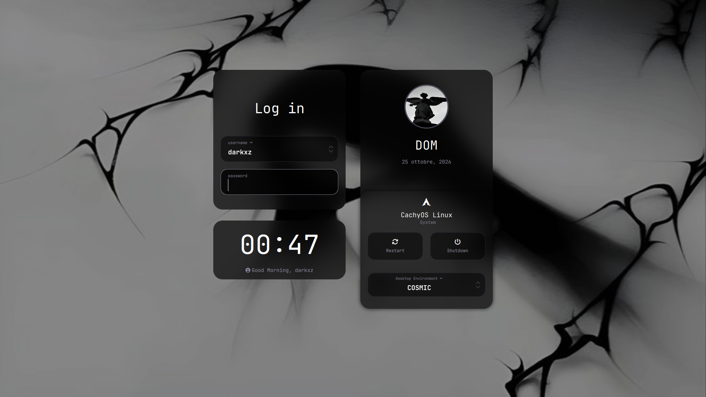

# 🖤 Stealth Dark SDDM Theme

A sleek, modern, dark glassmorphism theme for SDDM (Linux login screen). Features smooth animations, dynamic background blur, real user profile pictures, and deep dark aesthetic components.

Optimized for **CachyOS**, **Arch Linux**, **Ubuntu**, **Linux Mint**, **Debian**, **Pop!_OS**, and any Linux distribution using SDDM!

---

## 📸 Preview



---

## ✨ Features
- 🖤 **Dark Glassmorphism**: Elegant semi-transparent dark UI elements with clean borders.
- 🌫️ **Dynamic Blur**: Automatically blurs your background wallpaper behind the login cards.
- 🌊 **Smooth Animations**: Fluid fade-in and scale transitions for dropdown menus and buttons.
- 👤 **Real User Avatar**: Displays your actual Linux user profile picture automatically.
- 🇬🇧 **Forced English Date**: Days and months formatted in English regardless of system locale.
- 🚀 **Full Session Support**: Fully supports Wayland & X11 (Hyprland, COSMIC, KDE Plasma, GNOME, etc.).

---

## 🛠️ Step-by-Step Installation Guide

### Step 1: Install Required Dependencies

**For Arch Linux / CachyOS / Manjaro (`pacman`):**
```bash
sudo pacman -S qt5-graphicaleffects qt5-quickcontrols qt5-quickcontrols2 qt6-5compat
```

**For Ubuntu / Linux Mint / Pop!_OS / Debian (`apt`):**
```bash
sudo apt update && sudo apt install -y qml-module-qtgraphicaleffects qml-module-qtquick-controls qml-module-qtquick-controls2 qml-module-qtquick-layouts sddm git
```

---

### Step 2: Download the theme from GitHub
```bash
git clone https://github.com/madebydarkxz/stealth-dark-sddm.git
```

---

### Step 3: Enter the downloaded theme folder
```bash
cd stealth-dark-sddm
```

---

### Step 4: Copy the theme to SDDM system folder
```bash
sudo cp -r . /usr/share/sddm/themes/stealth-dark
```

---

### Step 5: Ensure configuration directory exists
```bash
sudo mkdir -p /etc/sddm.conf.d
```

---

### Step 6: Create configuration header
```bash
echo "[Theme]" | sudo tee /etc/sddm.conf.d/theme.conf
```

---

### Step 7: Activate the Stealth Dark theme
```bash
echo "Current=stealth-dark" | sudo tee -a /etc/sddm.conf.d/theme.conf
```

---

### Step 8: Test the theme (without rebooting!)
```bash
sddm-greeter --test-mode --theme /usr/share/sddm/themes/stealth-dark
```

---

## 🖼️ Custom Wallpaper

You can easily use your own wallpaper:
1. Rename your preferred image to `background.jpg`.
2. Replace the `background.jpg` file located in `/usr/share/sddm/themes/stealth-dark/` with your image.

---

## 📜 Credits
- Based on the original **Ronin** theme.
- Completely overhauled and updated for dark glassmorphism aesthetic, smooth transitions, and multi-distro compatibility by **madebydarkxz**.
